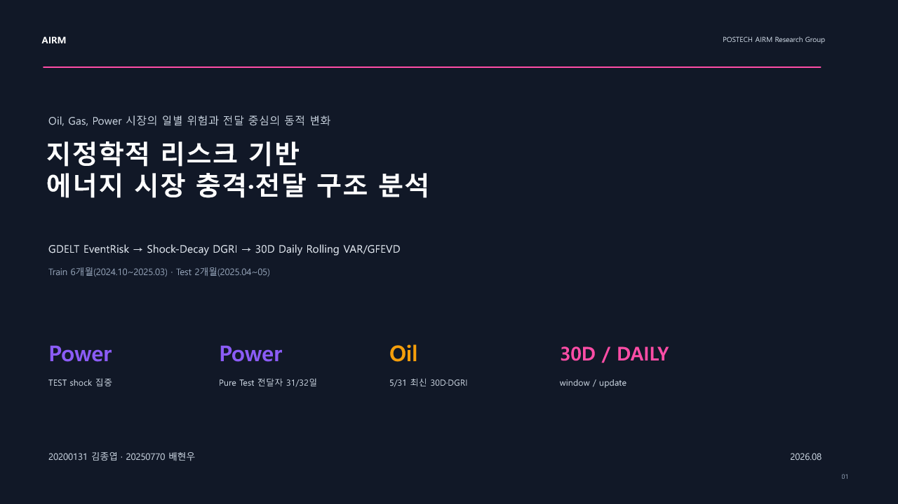
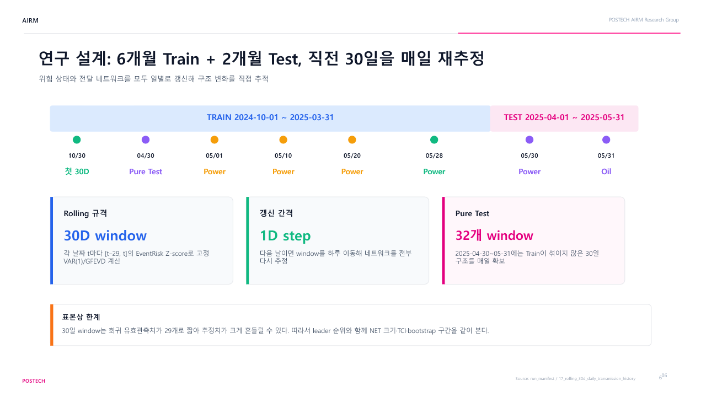
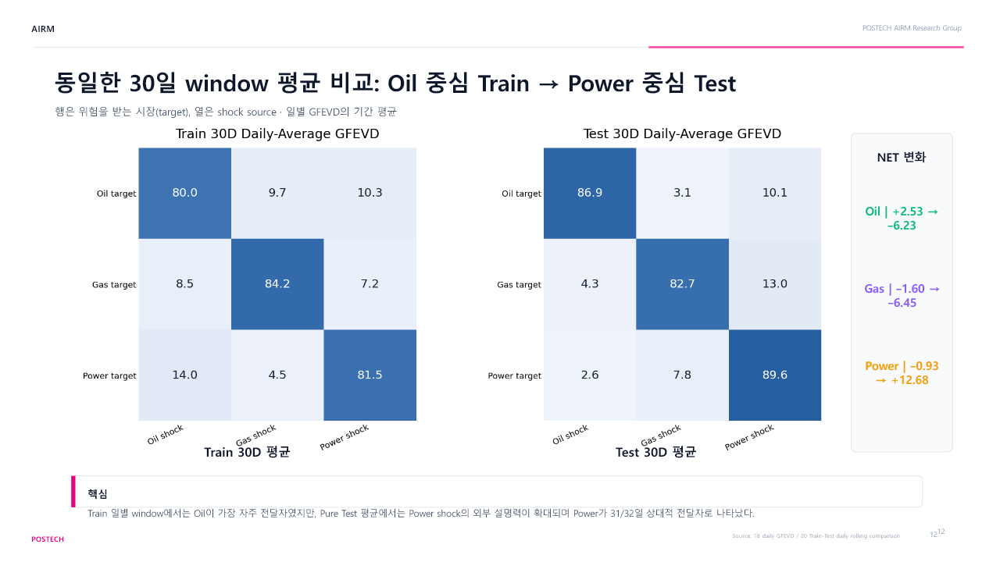

# DGRI · 발표 미리보기

**지정학적 리스크 기반 에너지 시장 충격·전달 구조 분석**

POSTECH AIRM Research Group · 김종엽 · 배현우

[PowerPoint 전체 19쪽 다운로드 · 상세 발표 대본 포함](reports/dgri_roll30_daily.pptx) · [프로젝트 요약](README.md)

## 연구 개요 · 1쪽

## Train / Test와 이동창 설계 · 6쪽

## 일별 상대적 전달자 · 10쪽

## Train / Test 전달구조 비교 · 12쪽

