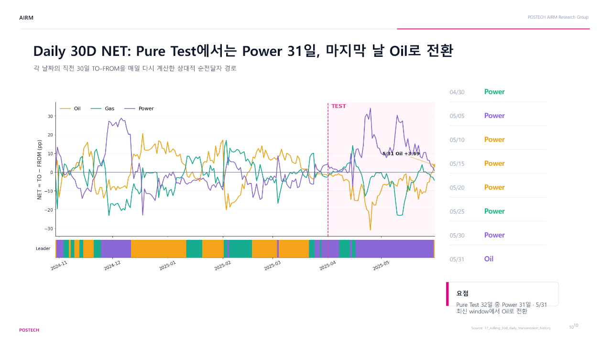

# 에너지 시장 뉴스 위험과 DGRI

GDELT 이벤트·기사로 원유, 천연가스, 전력의 위험지수를 만들고 시장 간 위험 전달 구조를 분석했습니다.

**POSTECH AIRM Research Group** · 김종엽, 배현우  
[발표 보기](PRESENTATION.md) · [PowerPoint 19쪽·발표 대본](reports/dgri_roll30_daily.pptx)

## 결과

평가 구간의 30일 이동창에서는 전력이 상대적 위험 전달자로 나타난 날이 많았습니다. 마지막 이동창에서는 원유로 바뀌었지만, 추정 구간이 넓어 변화가 확정됐다고 보기는 어렵습니다.

| 지표 | 공동 발표 결과 |
|---|---|
| Pure Test에서 전력이 상대적 전달자인 날 | 31 / 32일 |
| 30일 이동창 평균 TCI | 학습 18.1% → Pure Test 13.6% |
| 마지막 이동창 기준일 | 2025-05-31 |
| 마지막 날 원유 NET | +3.69pp |
| 원유 NET의 95% bootstrap 구간 | [−28.64, 31.04] |

TCI는 전체 연결성 지수입니다. NET은 해당 시장이 전달한 위험에서 받은 위험을 뺀 값이며, 양수면 순전달자로 해석합니다. Pure Test는 이동창 전체가 평가 구간에 들어오는 **2025-04-30–05-31**입니다.

출처: 공동 발표자료 10·11·16쪽. 짧은 표본에서 얻은 탐색적 결과이며 구조적 인과관계나 확정된 체제 전환을 뜻하지 않습니다.

## 분석 설계

| 항목 | 설정 |
|---|---|
| 시장 | 원유 · 천연가스 · 전력 |
| 전체 기간 | 2024-10-01–2025-05-31 |
| 학습 구간 | 2024-10-01–2025-03-31 |
| 평가 구간 | 2025-04-01–2025-05-31 |
| 기본 지수 / 비교 지수 | SOFT-70 / RAW, STRICT-70 |
| 이동창 | 30달력일 VAR(1), 유효 연속 관측 최소 25개 |

시장별 EventRisk를 구한 뒤 위험의 축적·감쇠를 반영해 DGRI를 구성합니다. VAR와 GFEVD로 시장 간 연결성을 추정합니다.

EventRisk가 결측인 날에는 새 충격을 추가하지 않고 기존 상태만 감쇠합니다. 미수집, 부분 수집, 실제 0을 구분해 처리합니다.

## 코드와 실행 순서

| 단계 | 코드 | 다음 단계 입력 |
|---|---|---|
| 1. 뉴스 수집 | [01_collect_event_risk.py](src/01_collect_event_risk.py) | EventRisk, `dgri_input.csv` |
| 2. 지수 구성 | [02_build_dgri.py](src/02_build_dgri.py) | RAW / SOFT-70 / STRICT-70 |
| 3. 전이 분석 | [03_analyze_risk_transmission.py](src/03_analyze_risk_transmission.py) | TCI, 위험 전이 통계 |

세 단계는 같은 실행 폴더에서 **01 → 02 → 03** 순서로 실행합니다. 2단계는 학습 구간의 감쇠계수와 기준분포를 적용하고, 3단계는 bootstrap과 일별 이동창 추정을 수행합니다.

`python prepare_run.py --run-id research_001`로 실행 폴더를 구성할 수 있습니다. 패키지는 [requirements.txt](requirements.txt)에 있으며, 1·3단계 코드에는 누락 패키지를 자동 설치하는 부분이 있습니다. 기사 수집에는 네트워크 연결이 필요합니다.

전체 수집·추정을 새 환경에서 재실행하는 검증은 아직 완료하지 않았습니다.

[발표 주요 페이지](PRESENTATION.md) · [데이터 범위와 재현 조건](DATA_POLICY.md)
