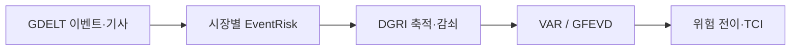

# Commodity Risk DGRI

**원유·천연가스·전력의 뉴스 위험지수와 시장 간 위험 전이**

[1. 뉴스 수집](src/01_collect_event_risk.py) · [2. DGRI 구성](src/02_build_dgri.py) · [3. 위험 전이 분석](src/03_analyze_risk_transmission.py)

## 연구 질문

GDELT 이벤트와 기사 본문으로 시장별 EventRisk를 구성하고, 위험의 축적·감쇠를 반영한 DGRI가 시장 사이에서 어떻게 연결되는지 분석한다.

## 분석 설계

| 항목 | 설정 |
|---|---|
| 시장 | 원유 · 천연가스 · 전력 |
| 전체 기간 | 2024-10-01–2025-05-31 |
| 학습 / 평가 | 2024-10-01–2025-03-31 / 2025-04-01–2025-05-31 |
| 기본 지수 | SOFT-70 |
| 민감도 비교 | RAW · STRICT-70 |
| 이동창 | 30달력일 VAR(1) · 유효 연속 관측 최소 25개 |

## 단계별 구성

| 단계 | 처리 | 산출물 |
|---|---|---|
| 수집 | 이벤트·기사 분류, 시장별 관측 범위와 품질 점검 | EventRisk · `dgri_input.csv` |
| 지수 | 학습 구간의 감쇠계수와 기준분포 적용 | RAW / SOFT-70 / STRICT-70 |
| 전이 | VAR·GFEVD, bootstrap, 일별 이동창 추정 | TCI · 충격·위험 전이 통계 |

EventRisk 결측일에는 새 충격을 추가하지 않고 기존 상태를 감쇠한다. 자료 미수집, 부분 수집, 실제 0을 구분한다.

이 저장소는 분석 코드 중심이며 결과 보고서나 성과 통계는 포함하지 않는다.

실행 의존성

패키지 목록은 `requirements.txt`에 있다. 세 단계는 같은 실행 폴더에서 01 → 02 → 03 순으로 연결된다. 2단계는 1단계의 `dgri_input.csv`, 3단계는 2단계 출력을 사용한다. 1·3단계에는 누락 패키지 자동 설치 코드가 포함돼 있다.

실행 폴더 구성: `python prepare_run.py --run-id research_001`. 기사 수집에는 네트워크 연결이 필요하다. 전체 수집·추정 과정의 새 환경 재현은 미검증 상태다.

[데이터 범위](DATA_POLICY.md)
